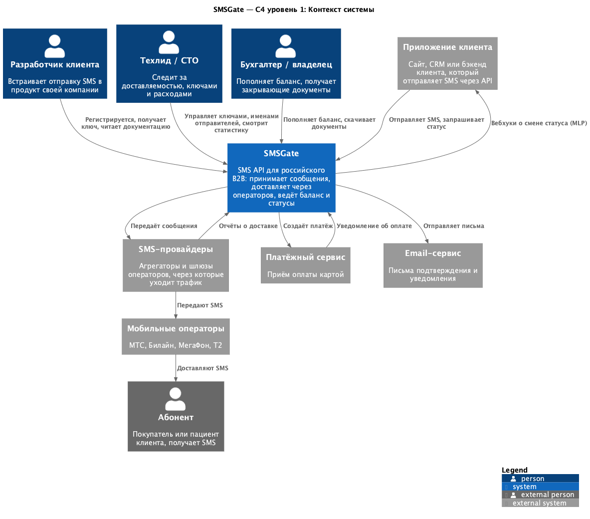
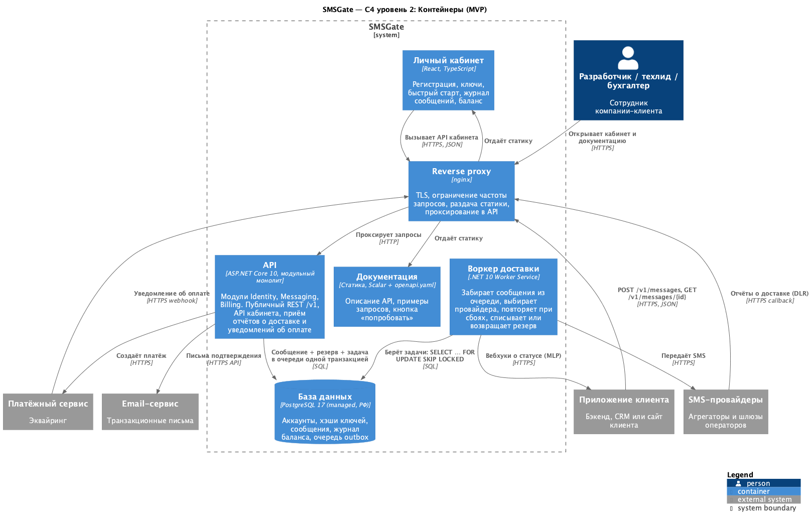

# SMSGate — ДЗ 5. Схема C4 и стек MVP

> Продолжение [ДЗ 4](HW4-design.md). Доменные зоны (Identity, Messaging, Delivery, Billing, Webhooks) взяты оттуда.

---

## Теория (кратко по лекции)

**C4** — способ рисовать архитектуру «как Google Maps»: от вида на всю страну до отдельной улицы. Четыре уровня приближения:

| Уровень | Что показывает | Для кого |
|---|---|---|
| **1. Context** | Система целиком — один квадрат. Вокруг люди и внешние системы, с которыми она общается | Инвестор, менеджер, любой нетехнический человек |
| **2. Containers** | Из каких запускаемых частей состоит система: приложения, сервер, БД. Здесь появляются технологии | Разработчики, DevOps, архитектор |
| 3. Components | Устройство одного контейнера: модули, сервисы, контроллеры. Часто совпадает со структурой папок | Разработчики этого контейнера |
| 4. Code | Классы и интерфейсы, как UML-диаграмма классов. На практике почти не рисуют | — |

Правила, которые важны для ДЗ:
- **Уровень 1 — без технологий.** Никаких «PostgreSQL» и «C#». Синий квадрат — то, что пишем мы. Серые квадраты — чужие системы, которые мы не контролируем.
- **Контейнер — это то, что можно запустить:** приложение, сервер, база, хранилище файлов. Каждый контейнер делает свою работу: в примере из лекции nginx «держит удар», Python думает, PostgreSQL хранит данные, S3 хранит файлы.
- **Стек выбирается под задачу бизнеса.** Для MVP главная задача — скорость разработки, а не модность технологий (вспоминаем Hype-Driven и Resume-Driven Development из прошлой лекции).

Что ещё было в лекции и пригодилось ниже:
- **Gunicorn и Go:** Python обслуживает запросы процессами-воркерами (CPU × 2). У Go горутины, и один инстанс держит 10 000+ одновременных запросов.
- **nginx:** HTTPS, фильтрация мусора, отдача статики, защита от медленных клиентов, кэш.
- **Файлы:** локально + nginx или объектное хранилище S3.
- **Платёжный треугольник:** как приложение узнаёт, что оплата прошла. Варианты: polling, deep link, WebSocket.
- **Очереди по возрастанию сложности:** асинхронность в памяти → очередь в PostgreSQL → Redis + Celery → RabbitMQ / Kafka.

---

## Уровень 1. Контекст

Исходник: [c4/c4-context.puml](c4/c4-context.puml)

| Элемент | Тип | Роль |
|---|---|---|
| **SMSGate** | Наша система | Принимает SMS по API, доставляет через операторов, ведёт баланс и статусы |
| Разработчик, Техлид, Бухгалтер | Пользователи | Роли из ДЗ 3 |
| Приложение клиента | Внешняя система | Отправляет SMS через наш API. В MLP получает от нас вебхуки |
| SMS-провайдеры → Операторы → Абонент | Внешние | Цепочка, по которой SMS физически доходит до человека |
| Платёжный сервис | Внешняя система | Приём оплаты картой |
| Email-сервис | Внешняя система | Письма подтверждения |

## Уровень 2. Контейнеры (MVP)

Исходник: [c4/c4-container.puml](c4/c4-container.puml)

| Контейнер | Технология | Что делает |
|---|---|---|
| Reverse proxy | nginx | Единая точка входа: TLS, ограничение частоты запросов, раздача статики кабинета и документации |
| Личный кабинет | React + TypeScript (SPA) | Экраны из ДЗ 4: регистрация, быстрый старт, журнал. Ходит в тот же API |
| Документация | Статика: Scalar + `openapi.yaml` | Справочник API из контракта ДЗ 4 с кнопкой «попробовать» |
| API | ASP.NET Core 10, модульный монолит | Модули Identity, Messaging, Billing. Принимает запросы клиентов, отчёты о доставке и уведомления об оплате |
| Воркер доставки | .NET 10 Worker Service | Отправляет SMS провайдерам, повторяет при сбоях, закрывает резерв (списание или возврат) |
| База данных | PostgreSQL 17, managed, в РФ | Все данные и очередь задач |

### Как идёт одно SMS по контейнерам
1. Приложение клиента → nginx → **API**: `POST /v1/messages`.
2. API **одной транзакцией** пишет в PostgreSQL сообщение, резерв денег и задачу в очередь (outbox), затем отвечает `202`.
3. **Воркер** забирает задачу (`SELECT … FOR UPDATE SKIP LOCKED`) и передаёт SMS провайдеру.
4. Провайдер присылает отчёт о доставке → nginx → API. API меняет статус, а воркер списывает деньги или возвращает резерв.

---

## Выбор технологий для MVP

| Решение | Выбор | Почему | Почему не другое |
|---|---|---|---|
| Язык и фреймворк | **C# / ASP.NET Core 10 (LTS)** | Команда пишет на C#, а скорость MVP = знакомый стек. Производительность: асинхронный Kestrel держит тысячи одновременных запросов на одном инстансе, как Go из лекции, без Gunicorn. .NET SDK уже обещан в Lean Canvas | Python (FastAPI) быстрее для прототипа, но его пришлось бы учить. Go быстр, но опыта в нём нет. Лекция: стек выбирается под задачу и команду, а не по моде |
| Архитектура | **Модульный монолит**: модули = доменные зоны из ДЗ 4 | Один деплой, одна БД, проще отлаживать. Границы модулей уже проведены по DDD, поэтому любой модуль потом можно вынести в отдельный сервис | Микросервисы на старте — Hype-Driven Development: Kubernetes и сеть между сервисами без нагрузки, которая их оправдывает |
| Отдельный воркер | **.NET Worker Service** из того же решения | Отправка провайдеру может тормозить секунды, а API должен отвечать за 300 мс (НФТ-2.1). Поэтому разные процессы: API масштабируется отдельно от доставки | Фоновые задачи внутри API теряются при перезапуске, а наше требование — «принятое SMS не теряется» (НФТ-2.3) |
| База данных | **PostgreSQL** | Деньги требуют ACID-транзакций: сообщение, резерв и списание должны быть согласованы. Уникальный индекс даёт идемпотентность. Managed-версия в Yandex Cloud или Selectel — без админа | NoSQL не даёт транзакций по деньгам. MySQL возможен, но у PostgreSQL удобнее `SKIP LOCKED` и JSONB |
| Очередь | **Очередь в PostgreSQL** (таблица outbox + `SKIP LOCKED`) | Второй уровень из лекции. Ноль новой инфраструктуры. Главное — задача в очередь пишется в той же транзакции, что и резерв денег, поэтому не бывает ситуации «деньги заблокированы, а SMS не в очереди» | RabbitMQ или Kafka — лишний сервис и проблема двух записей (БД + брокер). Переходим на RabbitMQ, когда упрёмся примерно в сотни SMS в секунду |
| Кэш, rate limit | **Без Redis** в MVP. Rate limit в nginx и встроенный `RateLimiter` ASP.NET | Один инстанс API — лимиты в памяти работают. Меньше движущихся частей | Redis добавим, когда API станет больше одного инстанса |
| Вход | **nginx** | Всё из лекции: TLS, фильтрация мусора, статика, защита от медленных клиентов. Отдельный location для отчётов о доставке и оплат | Выставлять Kestrel напрямую в интернет можно, но статику и TLS удобнее держать в nginx |
| Кабинет | **React + TypeScript SPA** | Это первый клиент нашего же API (API-First из ДЗ 4): всё, что умеет кабинет, умеет и API. Статика через nginx, отдельный сервер не нужен | Server-side рендеринг (Razor) смешал бы API и UI. Кабинет простой, SEO ему не нужно |
| Документация | **Scalar** по `openapi.yaml` | Документация генерируется из контракта и не устаревает. Даёт быстрый старт за 10 минут (US-10) | Писать документацию вручную — она разойдётся с API |
| Файлы | **Не нужны** в MVP | Медиа нет. Закрывающие документы в MVP выставляются вручную (ДЗ 3) | S3 подключим вместе с автоматическими актами (US-17) |
| Оплата | **Провайдер эквайринга + webhook** | Платёжный треугольник из лекции: провайдер сам сообщает об оплате вебхуком в API, а кабинет раз в несколько секунд опрашивает баланс (polling) | WebSocket ради одного экрана оплаты — избыточно |
| Хостинг | **Российское облако** (Yandex Cloud / Selectel), managed PostgreSQL | 152-ФЗ: номера и тексты SMS — персональные данные, они должны храниться в РФ (НФТ-2.6) | AWS и прочие зарубежные облака не подходят по закону |

### Когда стек поменяется
| Сигнал | Что делаем |
|---|---|
| Сотни SMS в секунду, очередь в БД тормозит | Очередь → RabbitMQ, outbox остаётся для надёжной публикации |
| API больше одного инстанса | Добавляем Redis для общего rate limit и кэша |
| Автоматические акты (US-17) | S3-совместимое хранилище для PDF |
| Отдельная команда на доставку | Выносим модуль Delivery в свой сервис по границе из ДЗ 4 |
