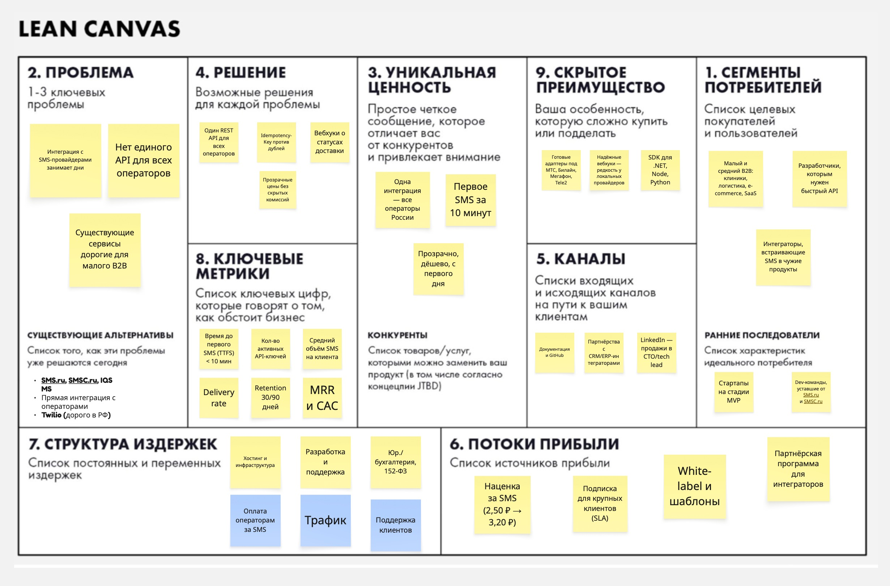

# SMSGate — B2B сервис доставки SMS

## Elevator Pitch

> Мы делаем SMS API для российского B2B-рынка. Одна интеграция — все операторы (МТС, Билайн, Мегафон, Tele2), прозрачные цены, идемпотентность и вебхуки из коробки. Разработчик отправляет первое SMS за 10 минут, а не за 3 дня. Существующие сервисы либо дорогие, либо перегружены — мы даём минимум, который закрывает 90% задач. Монетизация — наценка за SMS и подписка для крупных клиентов. Рынок SMS в России — десятки миллиардов рублей в год, и малый B2B до сих пор недообслужен.

**Одна строка:** SMS API для российского B2B: одна интеграция — все операторы, первое SMS за 10 минут.

---

## Lean Canvas

### 2. ПРОБЛЕМА
1. Компании тратят дни на интеграцию с SMS-провайдерами (разные API, разные форматы, слабая документация).
2. Нет единого места для отправки, отслеживания статусов и управления балансом.
3. Существующие сервисы (SMS.ru, SMSC.ru, IQSMS) — дорогие для малого B2B и сложны для быстрой интеграции.
4. Нет гибкого API с идемпотентностью и вебхуками «из коробки».

**Существующие альтернативы:**
- SMS.ru, SMSC.ru, IQSMS, Devino Telecom — мощные, но перегруженные и дорогие.
- Прямая интеграция с операторами (МТС, Билайн, Мегафон, Tele2) — долго и сложно.
- Twilio — дорого в России из-за конвертации и тарифов.

---

### 4. РЕШЕНИЕ
- REST API с Bearer-токеном и идемпотентными ключами.
- Единый эндпоинт: отправка, статус, вебхуки, баланс, шаблоны.
- Адаптер провайдеров: одна интеграция → много операторов.
- Прозрачные цены за SMS, без скрытых комиссий.

---

### 3. УНИКАЛЬНАЯ ЦЕННОСТЬ
**«Одна интеграция — все SMS-операторы России. Прозрачно, дёшево, с первого дня.»**

Простое сообщение для разработчика: 5 минут до первого отправленного SMS.

---

### 9. СКРЫТОЕ ПРЕИМУЩЕСТВО
- Готовый адаптер под российских операторов (МТС, Билайн, Мегафон, Tele2) — конкуренты требуют ручной работы.
- Идемпотентность и надёжная доставка вебхуков — редкость у локальных провайдеров.
- OpenAPI-спека + SDK (.NET, Node, Python) — снижает порог входа.

---

### 5. КАНАЛЫ
- Developer-first: документация, GitHub, Habr, Dev.to.
- Партнёрства с CRM/ERP-интеграторами в России.
- Контент-маркетинг: «Как отправить SMS через API за 5 минут».
- Продажи через LinkedIn и Telegram-сообщества (CTO/tech lead средних компаний).

---

### 1. СЕГМЕНТЫ ПОТРЕБИТЕЛЕЙ
- Малый и средний B2B (клиники, логистика, e-commerce, SaaS).
- Разработчики, которым нужен быстрый API без бюрократии.
- Интеграторы, встраивающие SMS в чужие продукты.

**Ранние последователи:**
- Стартапы в России, которые делают MVP и им нужны SMS-уведомления.
- Dev-команды, уставшие от SMS.ru и SMSC.ru.

---

### 8. КЛЮЧЕВЫЕ МЕТРИКИ
- Время до первого отправленного SMS (TTFS) — цель < 10 минут.
- Кол-во активных API-ключей.
- Средний объём SMS на клиента / месяц.
- % успешной доставки (delivery rate).
- Retention через 30/90 дней.
- MRR и стоимость привлечения (CAC).

---

### 7. СТРУКТУРА ИЗДЕРЖЕК
**Постоянные:**
- Хостинг и инфраструктура.
- Разработка и поддержка.
- Юр./бухгалтерия, 152-ФЗ-комплаенс.

**Переменные:**
- Оплата операторам за SMS (основная статья).
- Трафик.
- Поддержка клиентов.

---

### 6. ПОТОКИ ПРИБЫЛИ
- Оплата за SMS с наценкой (например, 2,50 ₽ → продажа 3,20 ₽).
- Подписка для крупных клиентов (SLA, приоритетная поддержка).
- Платные шаблоны и white-label.
- Партнёрская программа для интеграторов (% от оборота).
